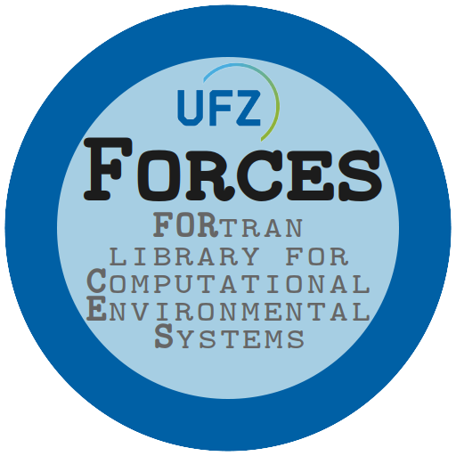

# FORCES library

<div align="center">

</div>

This is the FORTRAN library for Computational Environmental Systems of the

> Department Computational Hydrosystems<br/>
> Helmholtz Centre for Environmental Research - UFZ<br/>
> Permoserstr. 15<br/>
> 04318 Leipzig, Germany

It is a lightweight fork of the `jams_fortran` library maintained by Matthias Cuntz et al: https://github.com/mcuntz/jams_fortran

The `jams_fortran` library was formerly developed at the CHS department at the UFZ and is now released under the [MIT license](https://github.com/mcuntz/jams_fortran/blob/master/LICENSE).

[TOC]

## Quick start

### Requirements

Use C and supported Fortran compilers, CMake 3.18 or newer, and Make or Ninja.
The default build also needs NetCDF-C. Fypp is optional; generated Fortran
sources are included. Supported compilers, Conda installation and optional
features are described in the [user guide](doc/user-guide.md).

### Build and run

From a FORCES checkout with the dependencies installed, save this program as
`test.f90` in the repository root:

```fortran
program test
  use mo_message, only: message
  implicit none
  call message("This is working!")
end program test
```

Configure, build and run it from the repository root:

```bash
cmake -S . -B build -DCMAKE_BUILD_TYPE=Release -DFORCES_EXE=test.f90
cmake --build build --parallel
./build/main
```

The program prints:

```text
This is working!
```

`FORCES_EXE` selects a local program to link against the `forces` library target;
the resulting executable is named `main`. You can also select a program from
`examples/`, for example
`-DFORCES_EXE=examples/01_grids/01_regridding.f90`. Run fixture-based examples
from the repository root so relative input paths resolve.

For integration into your own CMake project, including fetching a release with
CPM, follow the [user guide](doc/user-guide.md).

## Documentation

The [online manual](https://forces.readthedocs.io/) provides versioned HTML/PDF
API documentation and example source listings.

| Guide | Contents |
| --- | --- |
| [Using FORCES](doc/user-guide.md) | Installation, build options, application integration, messages and CLI logging. |
| [Developing FORCES](doc/development-guide.md) | Module relationships, extension workflows, regression tests and coverage. |
| [Documentation workflow](doc/documentation-guide.md) | Building and publishing the HTML/PDF manual. |
| [Release notes](doc/CHANGELOG.md) | Changes between releases. |

Repository workflows and coding conventions are recorded in
[AGENTS.md](AGENTS.md). Development and test commands live in the developer guide;
normal library builds do not require pFUnit.

## License {#license-overview}

LGPLv3 (c) 2005-2026 CHS-Developers. See [LICENSE.md](LICENSE.md).
